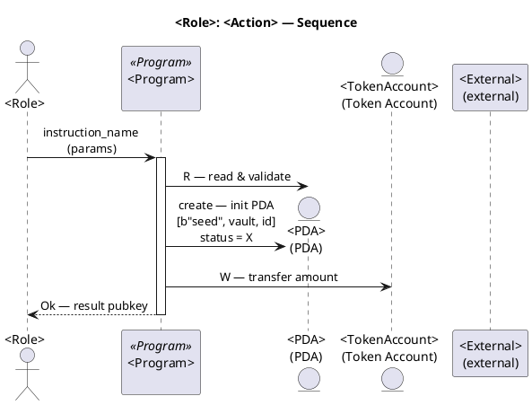
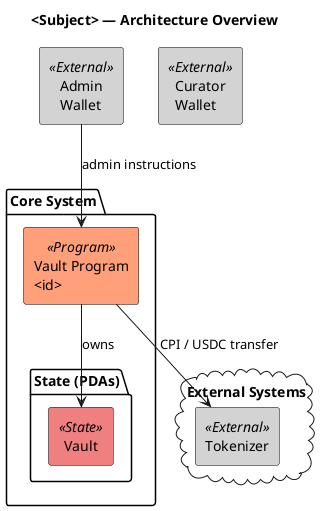

# PlantUML Diagrams Skill

## When to Use
- Create or update a **data model** diagram (classes, PDAs, accounts, instructions, programs)
- Create or update a **sequence** diagram (actor → participant message flows, protocol steps)
- Create or update a **use case / architecture** diagram (component overview, system boundaries)
- Requested via: _"draw", "diagram", "model", "visualise", "create a .puml"_, or editing an existing `.puml` file

## File Conventions

| Diagram type | File name pattern | Location |
|---|---|---|
| Data model (full) | `<subject>DataModel.puml` | `assets/img/` |
| Data model (role-scoped) | `<subject>DataModel-<role>.puml` | `assets/img/` |
| Sequence | `<subject>-<role>-<action>_SEQ.puml` | `assets/img/` |
| Use case / architecture | `<subject>.puml` | `assets/img/` |
| Shared styles | `common-styles.puml` | `assets/img/` (one per folder) |
| Reusable data modules | `<subject>_data_module.puml` (no `@startuml`) | `assets/img/` |

## Shared Style File

Always check for `common-styles.puml` in the same folder and `!include` it instead of duplicating skinparams.

If creating a new folder, scaffold `common-styles.puml`:

```plantuml
' Common skinparams — include via: !include common-styles.puml

!define INSTRUCTION class
!define EVENT class
!define ACCOUNT class
!define PROGRAM class
!define ACTOR class
!define PDA class

hide circles
skinparam classAttributeIconSize 0
skinparam class {
    BackgroundColor<<Account>> LightBlue
    BackgroundColor<<AssociatedTokenAccount>> LightCyan
    BackgroundColor<<Instruction>> LightYellow
    BackgroundColor<<Event>> LightGreen
    BackgroundColor<<PDA>> LightCoral
    BackgroundColor<<Program>> LightSalmon
    BackgroundColor<<wallet>> LightGray
    BorderColor Black
}
skinparam package {
    BackgroundColor #f9f9f9
    BorderColor #666666
}
```

---

## Procedure: Data Model Diagram

### 1. Structure

```plantuml
@startuml

title <Subject> — Data Model

!pragma layout smetana
top to bottom direction
scale max 2400 width
skinparam wrapWidth 220
allowmixing

!include common-styles.puml
' optional: !include <subject>_data_module.puml

' ========================================
' Actors
' ========================================
actor "Admin" as ActorAdmin
actor "Investor" as ActorInvestor
ActorAdmin -[hidden]right-> ActorInvestor

' ========================================
' Wallets
' ========================================
ACTOR AdminWallet <<wallet>> { ... }

ActorAdmin --> AdminWallet : owns

' ========================================
' Programs
' ========================================
package "Deployed Programs" {
    PROGRAM VaultProgram <<Program>> [[https://github.com/...]] {
        + ID: <pubkey>
        --
        **Core Functions:**
        - ...
    }
}

' ========================================
' PDAs / Accounts
' ========================================
package "Program State" {
    PDA VaultState <<PDA>> [[https://github.com/...]] {
        + bump: u8
        + admin: Pubkey
        --
        **Seeds:** [b"vault"]
        **Owner:** VaultProgram
        **Note:** ...
    }
}

' ========================================
' Instructions
' ========================================
package "<Role> Instructions" <<Rectangle>> {
    INSTRUCTION SomeInstruction <<Instruction>> [[https://github.com/...]] {
        + param: Type
        --
        Description of logic.
        **Authorization:** <role> only
    }
}

' ========================================
' Relationships
' ========================================
SomeInstruction --> VaultState : W
SomeInstruction --> SomePDA : creates

@enduml
```

### 2. Rules

- Use `!define` macros (`INSTRUCTION`, `PROGRAM`, `PDA`, `ACCOUNT`, `ACTOR`, `EVENT`) — never raw `class`
- Every entity with a source URL: add `[[https://github.com/...]]` after the name
- Separate fields from notes with `--`; document seeds, owner, and auth in notes
- Use `<<Stereotype>>` matching the skinparam colours (e.g., `<<PDA>>`, `<<Instruction>>`)
- Use `allowmixing` whenever actors coexist with class entities
- Layout hints: `-[hidden]right->` or `-[hidden]down->` to control positioning without visible arrows
- Use `scale max 3200 width` for wide instruction packages
- Always `hide circles` and `skinparam classAttributeIconSize 0`

---

## Procedure: Sequence Diagram

### 1. Structure



### 2. Rules

- Use `actor` for human roles (Admin, Curator, Investor)
- Use `participant` for programs; `entity` for accounts/PDAs
- Annotate arrows with the access mode: `R —`, `W —`, `R/W —`, or `creates`
- For PDA creation: `Entity ** : create — init PDA\n[b"seed", ...]`
- Wrap multi-line arrow labels with `\n`
- Use `activate` / `deactivate` to show program execution scope
- Use `alt … else … end` for error/alternate flows
- Use `== SECTION HEADING ==` separators for multi-phase flows
- Use `box "Name" #Colour … end box` to group related participants
- Inline notes: `note over Participant\n...\nend note` or `note right of Participant`
- URL links on messages: `\n[[https://github.com/...]]` appended to label

---

## Procedure: Use Case / Architecture Diagram

### 1. Structure



### 2. Rules

- Use `package` for logical groupings and `cloud` for external systems
- Add `[[URL]]` on components that have a source/doc link
- Use `rectangle` components with `<<Stereotype>>` for colour coding
- Keep labels concise; use `\n` for line breaks in component names

---

## Quality Checklist

Before saving a diagram, verify:

- [ ] Starts with `@startuml` and ends with `@enduml`
- [ ] Has a `title` line
- [ ] `!include common-styles.puml` present (data model) or inline skinparams (sequence/arch)
- [ ] All entities with source code use `[[URL]]` links
- [ ] Stereotypes match the skinparam colour table
- [ ] Arrow annotations indicate read (`R`), write (`W`), or create for data model diagrams
- [ ] PDA seeds are documented in entity notes
- [ ] Authorization requirements noted in instruction entities
- [ ] Layout hints used to avoid crossing arrows where possible
- [ ] File name follows the naming convention table above

## Referencing Diagrams

**Always reference `.puml` diagrams as `.svg`** in Markdown, YAML, or any documentation content (e.g., ``). A build process generates `.svg` files from `.puml` sources — never link directly to the `.puml` file.
