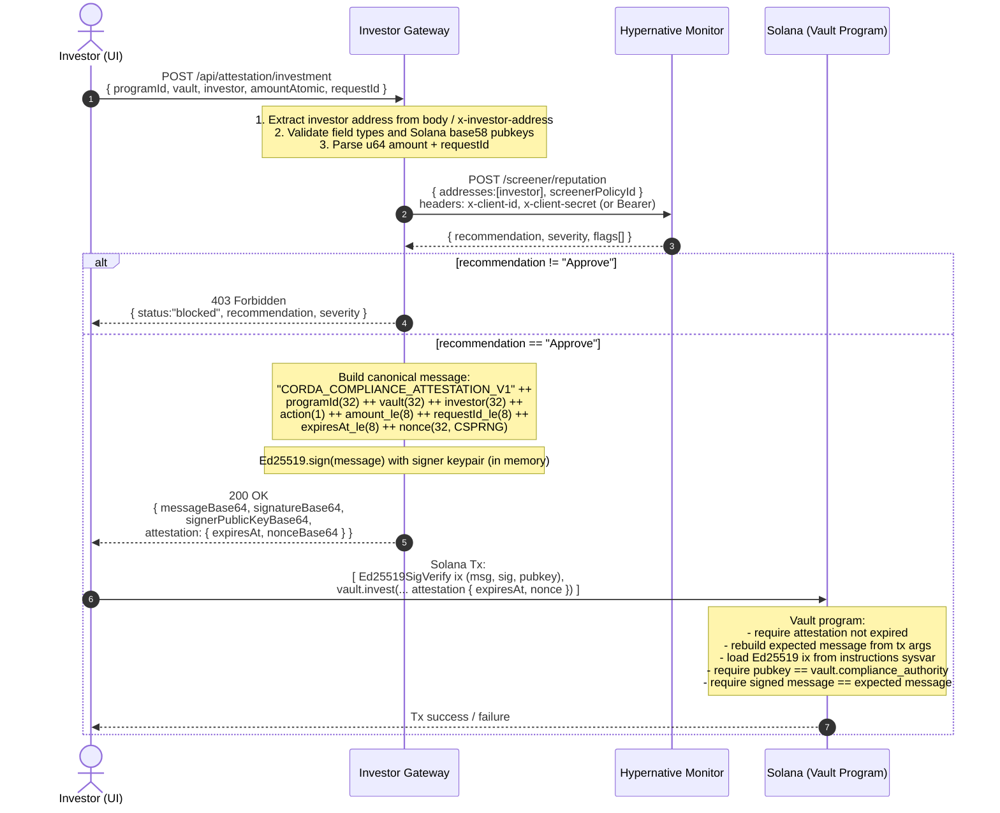

# Investor Gateway — Security Review

> Service: `services/investor-gateway`
> Owner: Protocol team
> Status: Draft for security review
> Source: `services/investor-gateway/src/main/kotlin/com/corda/investorgateway/`

## 1. Purpose

The Investor Gateway is a **stateless Kotlin/Ktor HTTP service** that sits between the investor UI and the Solana vault program. It performs two security-critical functions:

1. **Compliance screening** of investor wallet addresses via Hypernative Monitor (`POST /screener/reputation`).
2. **Production of signed on-chain compliance attestations** (Ed25519) that the vault program verifies on-chain before accepting investment / redemption transactions.

The on-chain attestation format is vendor-agnostic; Hypernative is the current screening backend but can be swapped without changing the on-chain protocol.

## 2. Architecture overview

| Component | Responsibility |
|---|---|
| `Application.kt` | Ktor module: route wiring, request parsing, response shaping, CORS |
| `GatewayRuntime.kt` | `HypernativeAddressScreener`, `HttpVaultForwarder`, address lookup helpers |
| `HypernativeModels.kt` | DTOs for the Hypernative `/screener/reputation` request/response |
| `ComplianceAttestationSigner.kt` | Ed25519 keypair load + canonical attestation message construction + signing |
| `application.conf` / `.env.example` | Configuration & secret bindings |

Runtime dependencies:

- **Hypernative Monitor API** (outbound HTTPS) — wallet-address reputation screening.
- **Solana on-chain vault program** (`programs/vault/`) — verifies the gateway-signed attestation against `vault.compliance_authority` (set to the gateway signer pubkey at vault config time). This is the **only** counterparty the standard UI flow relies on after the gateway returns its signed attestation.
- **Optional HTTP forward target** — a configurable URL (`VAULT_BASE_URL` + `VAULT_INVESTMENT_PATH` / `VAULT_REDEMPTION_PATH`) that the gateway POSTs to **only** when callers hit the legacy `/api/investment` and `/api/redemption` routes. **There is no such service shipped in this repository**; the config exists as a hook for hypothetical non-UI integrations. In local dev the operator typically points it at the gateway's own `/_local/vault/*` mock endpoints. The standard investor-UI flow does not use these routes.

The service holds **no persistent state** and **no investor PII**. It holds one secret in memory: the Ed25519 attestation signer keypair.

## 3. Endpoints

| Method | Path | Purpose | Auth |
|---|---|---|---|
| `GET`  | `/`                              | Built-in screening UI (HTML, local-tooling) | None |
| `GET`  | `/healthz`                       | Liveness + non-secret config echo | None |
| `POST` | `/api/screening`                 | Screen a wallet address only (no forward, no signing) | None |
| `POST` | `/api/investment`                | Screen + forward request body to configured `VAULT_BASE_URL` (legacy / non-UI path; no such target exists in this repo) | None |
| `POST` | `/api/redemption`                | Screen + forward request body to configured `VAULT_BASE_URL` (legacy / non-UI path; no such target exists in this repo) | None |
| `POST` | `/api/attestation/investment`    | Screen + sign on-chain investment attestation | None |
| `POST` | `/api/attestation/redemption`    | Screen + sign on-chain redemption attestation | None |
| `POST` | `/_local/vault/investments`      | Local mock forward target (dev only) | None |
| `POST` | `/_local/vault/redemptions`      | Local mock forward target (dev only) | None |

The gateway itself does **not authenticate inbound callers**. It is expected to be deployed behind an API gateway / WAF / network boundary that handles client authentication and rate limiting. The Solana program enforces the security invariant on-chain by requiring an Ed25519 signature from `vault.compliance_authority` on a canonical message bound to `(programId, vault, investor, action, amount, requestId, expiresAt, nonce)`.

## 4. Sequence diagram — signed attestation flow

This is the primary security-critical flow used by the investor UI.



### Plain-forwarding flow (`/api/investment`, `/api/redemption`) — legacy / non-UI

Same first three steps as above. On `Approve`, the original request body is forwarded byte-for-byte to `${VAULT_BASE_URL}${VAULT_INVESTMENT_PATH|REDEMPTION_PATH}` with selected request headers preserved (`Host`, `Content-Length`, `Connection`, `Transfer-Encoding` are stripped). The upstream HTTP response (status, body, content-type) is relayed back unchanged.

**Note for reviewers:** there is no in-repo HTTP service that consumes these forwards — `VAULT_BASE_URL` is an operator-configured hook for hypothetical non-UI integrations, and in this project's deployment topology it is unused. The standard UI flow uses the `/api/attestation/*` path above and submits the signed attestation directly on-chain; no HTTP traffic from the gateway to a "vault HTTP service" occurs.

## 5. Cryptography

### Attestation message format (canonical, version-tagged)

```
domain      : "CORDA_COMPLIANCE_ATTESTATION_V1"  (ASCII, 31 bytes)
program_id  : 32 bytes  (Solana pubkey of vault program)
vault       : 32 bytes  (Solana pubkey of vault account)
investor    : 32 bytes  (Solana pubkey of investor)
action      :  1 byte   (0 = INVESTMENT, 1 = REDEMPTION)
amount      :  8 bytes  (u64, little-endian, atomic units)
request_id  :  8 bytes  (u64, little-endian)
expires_at  :  8 bytes  (i64, little-endian, unix seconds)
nonce       : 32 bytes  (CSPRNG, per-attestation)
```

Rust verifier (`programs/vault/src/attestation.rs`) and Kotlin signer (`ComplianceAttestationSigner.kt`) build the exact same byte layout — any divergence rejects the transaction on-chain.

### Signer key

- Algorithm: **Ed25519** (JCA `Signature.getInstance("Ed25519")`).
- Key material: 64-byte Solana keypair (seed ‖ pubkey).
- Sources accepted: JSON byte array (`solana-keygen` output) or base64.
- Held only in process memory, loaded at boot from `GATEWAY_ATTESTATION_SIGNER_KEYPAIR`.
- On boot, `keypairIsConsistent()` signs a fixed challenge and verifies it against the embedded pubkey. Mismatch fails startup.
- The matching pubkey is configured on-chain as `vault.compliance_authority` via the vault admin tooling.

### Nonce / replay considerations

- Each attestation contains a fresh 32-byte CSPRNG nonce and a TTL (`expiresAt = now + GATEWAY_ATTESTATION_EXPIRES_IN_SECONDS`, default **300 s**).
- The on-chain program enforces `expiresAt >= now`, but does **not** track used nonces. Replay protection within the TTL window is provided by `request_id` being bound into the signed message and consumed by the vault program (request-id reuse is rejected by the vault state machine, not the attestation layer).
- Reviewers: please verify request-id uniqueness handling in the vault program is sufficient for the operational replay window.

## 6. Trust boundaries

```
┌───────────────────────────────────────────────────────────────────┐
│ Investor browser (untrusted)                                      │
└───────────────────────────────┬───────────────────────────────────┘
                                │ HTTPS (terminated by upstream LB)
┌───────────────────────────────▼───────────────────────────────────┐
│ Investor Gateway (trusted within deployment)                      │
│  • Holds Ed25519 signer keypair in memory                         │
│  • Holds Hypernative API credentials in memory                    │
└──────────┬──────────────────────────────────┬─────────────────────┘
           │ HTTPS                            │ HTTP/HTTPS (legacy /
           ▼                                  │  non-UI integrations only;
┌────────────────────────┐                    │  no such service in this repo)
│ Hypernative Monitor    │                    ▼
│ (external SaaS)        │         ┌────────────────────────────────┐
└────────────────────────┘         │ Operator-configured forward    │
                                   │ target (VAULT_BASE_URL)        │
                                   │ — unused by the investor UI    │
                                   └────────────────────────────────┘

   For the standard UI flow the gateway returns the signed
   attestation to the browser, which submits it directly on-chain:

                    User (browser)
                          │
                          │ Solana transaction with
                          │ Ed25519SigVerify + vault instruction
                          ▼
              ┌────────────────────────────────┐
              │ Solana vault program           │
              │ verifies Ed25519 attestation   │
              │ against vault.compliance_authority │
              └────────────────────────────────┘
```

Trust assumptions:

- Inbound auth and rate limiting are provided by the deployment fronting the gateway.
- Hypernative API credentials and the Ed25519 keypair are provisioned by the deployment platform's secret manager and exposed as env vars.
- Gateway → Hypernative goes over TLS to `api.hypernative.xyz`.
- Gateway → Vault HTTP forwarding URL is operator-configured; for the standard UI flow no vault HTTP service is contacted.

## 7. Configuration & secrets

Loaded from env (see `.env.example`). Secrets are **never** logged; non-secret config is echoed by `/healthz`.

| Env var | Sensitive | Purpose |
|---|---|---|
| `HTTP_PORT` | no | Listen port (default `8280`) |
| `HYPERNATIVE_BASE_URL` | no | Default `https://api.hypernative.xyz` |
| `HYPERNATIVE_CLIENT_ID` | yes | Sent as `x-client-id` |
| `HYPERNATIVE_CLIENT_SECRET` | yes | Sent as `x-client-secret` |
| `HYPERNATIVE_BEARER_TOKEN` | yes | Alternative: sent as `Authorization: Bearer …` |
| `HYPERNATIVE_SCREENER_POLICY_ID` | no | Hypernative policy applied to screening calls |
| `VAULT_BASE_URL` | no | Forward target for plain `/api/investment|redemption` |
| `VAULT_INVESTMENT_PATH` | no | Path appended for investment forwards |
| `VAULT_REDEMPTION_PATH` | no | Path appended for redemption forwards |
| `GATEWAY_ATTESTATION_SIGNER_KEYPAIR` | **yes** | 64-byte Ed25519 keypair (JSON array or base64) |
| `GATEWAY_ATTESTATION_EXPIRES_IN_SECONDS` | no | Attestation TTL, default `300` |
| `INVESTOR_ADDRESS_FIELD_PATHS` | no | CSV of JSON dotted-paths used to extract the investor address from request bodies |

The gateway client ID and policy ID are also rendered into the local screening UI HTML for operator visibility — neither is secret.

## 8. Input handling

- Request bodies are received as raw text (`receiveText()`) and parsed with `kotlinx.serialization` configured `ignoreUnknownKeys = true`.
- The investor address is located via:
  1. `x-investor-address` header (preferred), else
  2. configured dotted-path lookup in the JSON body (`INVESTOR_ADDRESS_FIELD_PATHS`), else
  3. fallback recursive search for known keys (`investorAddress`, `walletAddress`, `investorWalletAddress`).
- For attestation endpoints the address found above must match the `investor` field in the signed payload (case-insensitive). Mismatch → 400.
- Solana pubkeys are decoded via a custom base58 decoder; only 32-byte results are accepted.
- `amountAtomic` and `requestId` are parsed as **unsigned u64** (`String.toULong()`); negative or out-of-range values are rejected with 400.
- The HTML rendered by `GET /` HTML-escapes the rendered Hypernative client/policy IDs.

## 9. Outbound integration — Hypernative

- Endpoint: `POST {HYPERNATIVE_BASE_URL}/screener/reputation`.
- Auth: `x-client-id` + `x-client-secret`, and/or `Authorization: Bearer …` (whichever env vars are populated).
- Request body: `{ "addresses": [investor], "screenerPolicyId": <optional> }`.
- Response handling: non-2xx, non-decodable, or empty `data` array → `ScreeningClientException` → **502 Bad Gateway** to caller (with upstream status, headers, request body, and response body included for debugging — see "Logging" below for the trade-off).
- Decision rule: `recommendation == "Approve"` (case-insensitive) ⇒ `allowed = true`. **Anything else blocks**, including null/empty.

## 10. Outbound integration — HTTP forwarder (legacy / non-UI only)

- Used only for `/api/investment` and `/api/redemption`. The investor UI does not call these routes; it uses `/api/attestation/*`.
- **No in-repo target.** `VAULT_BASE_URL` is a configurable hook; this project does not ship an HTTP service that consumes the forwarded payloads. In local dev the operator points it at the gateway's own `/_local/vault/*` mock endpoints, which simply return `{"status":"ok",...}`.
- Forwards the **raw inbound body** unchanged; preserves most inbound headers.
- Headers stripped before forwarding: `Host`, `Content-Length`, `Connection`, `Transfer-Encoding`.
- Inbound `Content-Type` is preserved if present.
- Forward failures → **502 Bad Gateway**.

Reviewers may reasonably ask whether these endpoints should be removed or feature-gated in production builds, given they have no real consumer in the current topology.

## 11. Logging & observability

- Logger: `kotlin-logging` (KotlinLogging).
- `logBlockedRequest(...)` logs `address`, `recommendation`, `severity` at INFO when a request is blocked.
- Hypernative call failures are logged at ERROR with stack trace.
- **Reviewer note — verbose error responses:** on Hypernative call failure the gateway echoes the upstream request body, response body, and response headers back to the client (see `ErrorResponse.hypernative*` fields). This is intentional for the local screening UI but **may leak Hypernative internals or PII to remote callers in production**. Recommend gating these fields behind a debug flag before public exposure. (Tracked finding for review.)
- The screening HTML UI is intended as a local operator tool. The CORS policy currently uses `anyHost()` and allows `Content-Type` and `x-investor-address` for `GET`/`POST`, which should be tightened in production.

## 12. Dependencies (high level)

- Ktor server (Netty) + Ktor CIO HTTP client.
- `kotlinx.serialization` for JSON.
- `kotlin-logging` over slf4j.
- JDK Ed25519 (`java.security.Signature`, `KeyFactory`) — no third-party crypto.
- No database, no cache, no queue.

## 13. Open questions / suggested follow-ups for security review

1. **Inbound auth.** Confirm the deployment fronting the gateway authenticates and rate-limits callers; otherwise the attestation endpoint is an open oracle that signs anything an `Approve`'d wallet asks for, up to vault-program request-id constraints.
2. **Verbose error echoing.** Decide whether to gate the `hypernative*` error fields behind a debug toggle in production builds.
3. **CORS.** `anyHost()` is convenient for the local screening UI but should be narrowed to the investor UI origin(s) in production.
4. **Key custody.** Where is `GATEWAY_ATTESTATION_SIGNER_KEYPAIR` stored at rest, who can read it, and what is the key-rotation procedure (which also requires updating `vault.compliance_authority` on-chain)?
5. **Replay window.** The on-chain program does not track nonces; replay safety relies on the vault program's `request_id` handling and the 5-minute default TTL. Confirm `request_id` uniqueness enforcement covers the operational TTL window.
6. **Hypernative outage policy.** Today, an unreachable or non-2xx Hypernative response yields 502 (fail-closed). Confirm fail-closed is the desired posture under all production conditions.
7. **TLS posture.** Confirm outbound TLS verification cannot be disabled by configuration (currently uses Ktor CIO defaults).

## 14. Code references

- Routing & request shaping: `services/investor-gateway/src/main/kotlin/com/corda/investorgateway/Application.kt`
- Hypernative client + vault forwarder + address lookup: `services/investor-gateway/src/main/kotlin/com/corda/investorgateway/GatewayRuntime.kt`
- Attestation signer & canonical message: `services/investor-gateway/src/main/kotlin/com/corda/investorgateway/ComplianceAttestationSigner.kt`
- On-chain verifier (counterpart): `programs/vault/src/attestation.rs`
- Configuration: `services/investor-gateway/src/main/resources/application.conf`, `services/investor-gateway/.env.example`